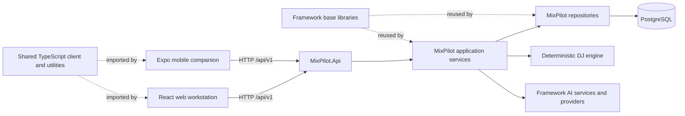
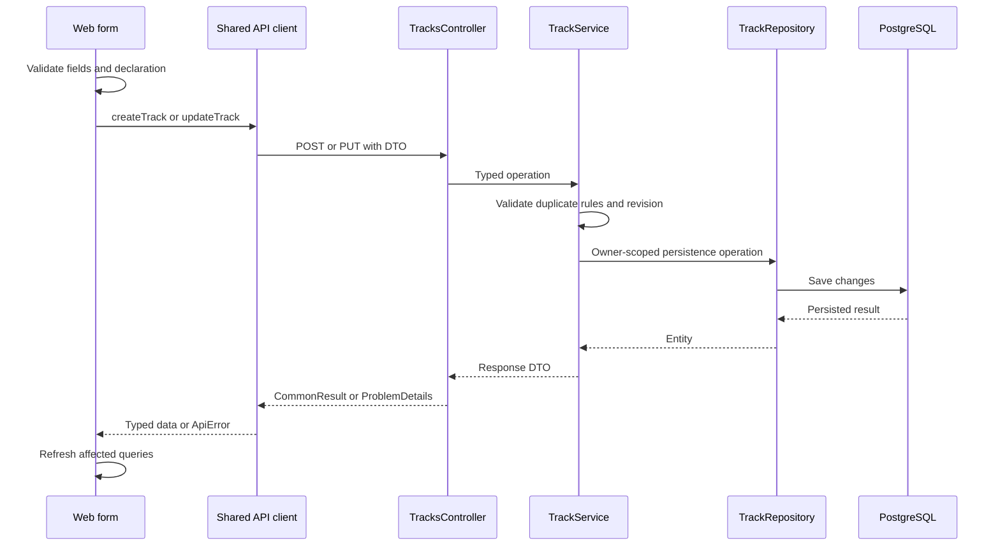
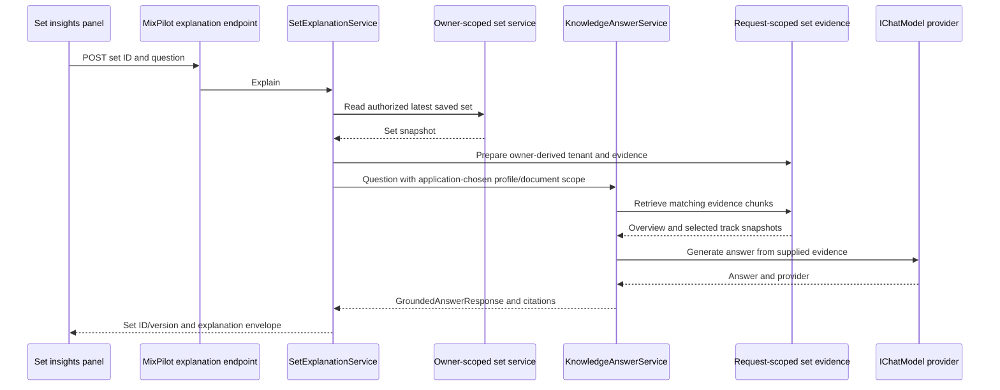

# MixPilot technical guide: backend and frontend workflows

Implementation snapshot: **9 October 2026**. This guide describes the code built so far, its runtime flows, local operation and remaining work. It is not a claim that every feature in the product documents is implemented or production-validated.

The functional PDFs, frontend architecture guide and dark UI board are design inputs. The current code and generated OpenAPI contract determine which workflows are available. Early MixPilot documents that describe the frontend as future work predate the frontend implementation documented here.

## Contents

1. [Workspace and ownership](#1-workspace-and-ownership)
2. [Current feature coverage](#2-current-feature-coverage)
3. [Backend layers and Framework reuse](#3-backend-layers-and-framework-reuse)
4. [Persistence and ownership](#4-persistence-and-ownership)
5. [Shared HTTP contract](#5-shared-http-contract)
6. [Library and playlist workflows](#6-library-and-playlist-workflows)
7. [Set generation and editing](#7-set-generation-and-editing)
8. [AI workflows](#8-ai-workflows)
9. [Web architecture and state](#9-web-architecture-and-state)
10. [Mobile architecture](#10-mobile-architecture)
11. [Authentication and configuration](#11-authentication-and-configuration)
12. [Local setup and first product loop](#12-local-setup-and-first-product-loop)
13. [Development and contract changes](#13-development-and-contract-changes)
14. [Verification and troubleshooting](#14-verification-and-troubleshooting)
15. [Remaining implementation work](#15-remaining-implementation-work)
16. [Source map](#16-source-map)

## 1. Workspace and ownership

The VS Code workspace is an editing convenience. It allows navigation across related folders without combining their solutions or runtime responsibilities.

```text
C:/Users/blinh/source/repos/
├── Framework/
│   ├── Framework.sln
│   └── docs/MIXPILOT_TECHNICAL_GUIDE.md
├── MixPilot/
│   ├── MixPilot.sln
│   ├── src/
│   ├── tests/
│   └── docs/openapi.json
└── MixPilot.Frontend/
    ├── apps/web/
    ├── apps/mobile/
    ├── packages/api-client/
    ├── packages/shared/
    └── pnpm-workspace.yaml
```

| Component | Owns | Relationship to the others |
| --- | --- | --- |
| Framework | Generic repositories/services/controllers, common contracts, EF infrastructure and provider-neutral AI building blocks | Reusable .NET libraries; contains its own reference API host |
| MixPilot | Music entities, library operations, rights rules, set planning, explanation evidence, persistence and product endpoints | References sibling Framework projects through `FrameworkRoot`; keeps its own solution |
| Frontend web | DJ workstation screens, browser session, forms, query cache and editor interactions | Calls MixPilot.Api over HTTP |
| Frontend mobile | Native library and set-review screens; future native account/platform integrations | Uses the same HTTP contracts and shared client |
| Shared frontend packages | Generated API types, typed HTTP operations, pure validation/formatting and theme tokens | Imported by web and mobile; no separate frontend Framework application |

`MixPilot.sln` contains MixPilot projects, not Framework projects listed as solution members. Its project references still build the Framework dependencies. `FrameworkRoot` defaults to the sibling `../Framework` directory.

**Framework.Api is not a runtime prerequisite for MixPilot.** MixPilot loads Framework libraries in its own process. The frontend does not route its DJ operations through Framework.Api.



## 2. Current feature coverage

| Capability | Backend | Web | Native mobile |
| --- | --- | --- | --- |
| Track metadata | Owner-scoped CRUD, query, pagination and revisions | Search, exact genre filter, sort, details, add/edit/delete | Search, pagination and details |
| CSV import | Synchronous, bounded, atomic metadata import | File selection, authorization declaration and result counts | Not exposed |
| Playlists/collections | Ordered membership and revisioned CRUD | Create from selected tracks; view members | Not exposed |
| DJ profile | Read and create/update preferences | Preferences form; handles a missing initial profile | Not exposed |
| Set planning | Structured requirements and deterministic selection | Generate and save first version | Review saved results |
| Set editor | Reorder/remove/replace/lock, regeneration, history | Draft editing, explicit save, historical view | Read-only review |
| Set explanations | Framework-backed, owner-scoped evidence | Capability-gated question/answer panel | Not exposed |
| BPM/key/energy visualization | Returns recorded metadata | Charts and track values | Metadata values |
| Account integration | JWT validation; explicit Development identity | OIDC code + PKCE shell; provider configuration remains necessary | Development preview only; production sign-in pending |
| Audio/media, discovery, exports, jobs | Not implemented | Clearly identified as unavailable/future features | Not implemented |

Generated sets are saved plans. They are not audio mixes. The word “AI” in the set-builder screen does not mean the selection algorithm currently calls a language model.

## 3. Backend layers and Framework reuse

The initial backend targets `net9.0` to match Framework. This records the implementation target; runtime/package support must be reviewed as part of release preparation.

| Project | Responsibility |
| --- | --- |
| `MixPilot.Api` | HTTP binding, authentication, authorization configuration, errors, OpenAPI, health endpoints and composition root |
| `MixPilot.Contracts` | Public request/response DTOs and input annotations; reusable by both clients |
| `MixPilot.Domain` | Music entities, rights, planning requirements, deterministic engine and rule violations |
| `MixPilot.Application` | Typed service/repository interfaces, use cases, revision checks, mapping, CSV parsing and AI evidence |
| `MixPilot.Infrastructure` | EF context, PostgreSQL, migrations, concrete repositories and dependency registration |
| `MixPilot.Tests` | Domain, relational, API, ownership, concurrency, layering and contract checks |

Incoming requests run **Controller → Service → Repository → Database**. Responses return through the service and controller. This is the runtime direction of the repository/service/controller layering.

```text
TracksController
  -> ITrackService / TrackService
    -> ITrackRepository / TrackRepository
      -> MixPilotDbContext
        -> PostgreSQL

CollectionsController -> ICollectionService -> ICollectionRepository
ProfileController     -> IDjProfileService  -> IDjProfileRepository
SetsController        -> ISetService        -> ISetRepository
```

Controllers do not query EF directly. Application services do not take an EF context or use repository `IQueryable` to implement database queries.

### Base repositories and services

`MixPilotRepository<TEntity>` derives from Framework's `BaseRepository<TEntity, Guid, MixPilotDbContext>`. Feature repositories add the searches/includes needed for tracks, collections, profiles and sets. They reuse generic persistence operations rather than introducing a separate store abstraction.

`MixPilotService<TEntity,TRepository>` derives from Framework's `BaseService<TEntity,Guid>`. Protected helpers reuse create, bulk-create, delete and save orchestration after feature validation. Already-validated aggregates use identity mappings. Tracked edits persist through the same scoped repository/context.

MixPilot blocks inherited public generic mutation entry points, including access through `IBaseService`. Otherwise, a generic mapped DTO could bypass expected-revision checks, ownership declarations or specialized rules. Controllers use focused interfaces under `Application/Abstractions/Services`; persistence interfaces live under `Application/Abstractions/Persistence`.

### Controllers and registration

Framework's generic base controllers remain reusable options. Current MixPilot controllers derive from ASP.NET Core `ControllerBase` and expose explicit product DTOs and operations. They reuse Framework result/pagination conventions without exposing unrestricted generic CRUD entry points.

`AddMixPilot(configuration)` registers scoped repositories/services and `MixPilotDbContext`, the deterministic engine, mappings and AI integration. Repositories within a request share the same scoped context. The API host supplies `ICurrentUser` and authentication.

The shared Framework change for AI reuse is the public `AddAiInfrastructure(configuration)` extension. MixPilot can register AI providers without invoking the reference host's database registration or creating a second application database.

## 4. Persistence and ownership

MixPilot uses PostgreSQL through EF Core and a `MixPilotDbContext` derived from `FrameworkDbContext`. Initial migrations are checked in; migrations run explicitly rather than on application startup.

| Model | Stored meaning |
| --- | --- |
| `Track` | Artist/title/version, duration, optional analysis metadata, genre/mood/vocals, source, availability, rights and duplicate identity |
| `Collection` / `CollectionTrack` | Named ordered group and unique membership relationships |
| `DjProfile` | One preference profile per owner |
| `DjSet` | Saved set identity, name, owner and current revision |
| `SetVersion` | Version number, timestamp and serialized plan snapshot |

Owned roots carry `OwnerKey`, ID, revision and timestamps. Owner identity comes from the validated issuer/subject pair. Clients never submit an owner key. EF query filters scope reads; service access checks validate relationships; save-time checks reject changes to another owner's entities.

`Revision` is an EF concurrency token. Services check `expectedRevision` before mutation; database concurrency protects simultaneous writers that pass an earlier read. Conflict responses use HTTP 409.

Collections enforce unique membership. A track referenced by a collection cannot be deleted until that membership is removed. The backend supports collection updates; the current web playlist screen does not yet expose full membership editing.

Set versions preserve historical metadata and rights as serialized snapshots. Library changes do not rewrite those snapshots. New edits/regeneration re-read current tracks and eligibility. Historical rights are evidence about the saved plan, not authorization for a future media operation.

### Rights and source semantics

Sources include `myLibrary`, `externalReference`, `licensedCatalog` and `platformOriginal`; source enum values do not imply that integrations exist.

New metadata registrations use `registeredMetadata`. An authorization declaration enables reference/planning, while audio-related permissions default false. The model distinguishes reference, analysis, streaming, download, tempo/key changes, mixing, audio export and publishing, plus territories and license dates.

`planning` filters reference eligibility. `mixable` adds mixing eligibility; it does not render audio. The current web builder uses planning mode. A URL, metadata record or saved snapshot must never be interpreted as permission to play/download/mix media.

## 5. Shared HTTP contract

Both clients consume `/api/v1`. C# contracts and the backend OpenAPI snapshot define the public boundary; browser/native screens do not have separate DTO families.

| Convention | Current behavior |
| --- | --- |
| JSON | camelCase properties and string enums; numeric enum values and unknown input fields are rejected |
| IDs/time | GUID strings; timestamps represented as ISO-8601; durations are integer seconds |
| Missing metadata | Nullable BPM/key/energy/vocals mean unknown; clients must preserve that distinction |
| Success | `CommonResult<T>` containing `succeeded`, `data`, `error` |
| Lists | `PageResponse<T>` with `items`, `pageNumber`, `pageSize`, `totalCount`, `totalPages` |
| Paging | One-based; default 20; maximum 100 per request |
| Creation | HTTP 201 with the created result and location where defined |
| Deletion | HTTP 204; the client does not parse a JSON body |
| Errors | `application/problem+json` with status/title/detail, stable code, trace ID and optional field errors |
| Revisions | Send the last fetched revision on updates/deletes; initial profile/collection writes use zero |

The generated query parameter names reflect ASP.NET/OpenAPI binding, including `PageNumber`, `PageSize` and `Search`. The shared client adapts convenient camelCase TypeScript query inputs to those generated names. JSON body naming remains camelCase.

Example list envelope:

```json
{
  "succeeded": true,
  "data": {
    "items": [],
    "pageNumber": 1,
    "pageSize": 20,
    "totalCount": 0,
    "totalPages": 0
  },
  "error": null
}
```

Illustrative conflict response (trace/detail values vary):

```json
{
  "type": "https://httpstatuses.com/409",
  "title": "Conflict",
  "status": 409,
  "detail": "The resource has changed. Reload before saving.",
  "code": "revision_conflict",
  "traceId": "request-trace-id"
}
```

### Endpoint inventory

All product operations require the configured authenticated identity. Operational health probes are anonymous.

| Method | Route | Purpose |
| --- | --- | --- |
| GET | `/api/v1/capabilities` | Implemented/planned feature flags and limits |
| GET / POST | `/api/v1/tracks` | Query library / register metadata |
| GET / PUT / DELETE | `/api/v1/tracks/{id}` | Detail / revisioned edit / revisioned delete |
| POST | `/api/v1/imports/csv` | Authorized CSV metadata import |
| GET / POST | `/api/v1/collections` | List / create ordered collection |
| GET / PUT / DELETE | `/api/v1/collections/{id}` | Read / update / delete collection |
| GET / PUT | `/api/v1/me/profile` | Read / create or update preferences |
| GET | `/api/v1/sets` | Paginated saved-set summaries |
| POST | `/api/v1/sets/generate` | Generate and persist a first version |
| GET | `/api/v1/sets/{id}` | Read latest plan |
| PUT | `/api/v1/sets/{id}/tracks` | Persist full desired order and lock set |
| POST | `/api/v1/sets/{id}/regenerate` | Generate a new version around saved locks |
| GET | `/api/v1/sets/{id}/versions` | Version metadata |
| GET | `/api/v1/sets/{id}/versions/{version}` | Historical plan |
| POST | `/api/v1/sets/{id}/explanation` | Explain latest saved set from authorized evidence |
| GET | `/health/live`, `/health/ready` | Process liveness / database readiness |

There are no implemented audio upload, playback, discovery, analysis-job, SignalR, DJ export, set rename or set delete endpoints. Do not infer endpoints from buttons in the reference UI board.

## 6. Library and playlist workflows

### Search and detail

1. The screen holds search/filter/sort/page state. Web and native library search debounce text input for 300 ms.
2. TanStack Query identifies the request by identity, resource and filters. Query cancellation propagates into the HTTP client.
3. `GET /tracks` reaches `ITrackService` and the owner-scoped repository. Search matches artist/title; genre is an exact filter.
4. The API returns a paginated DTO envelope. The client unwraps it and renders loading, error, empty or result states.
5. Selecting a track fetches its detail by ID. Unknown metadata renders distinctly, and the UI states that audio playback/analysis is unavailable.

### Register or edit metadata



Create input includes artist, title, duration and `authorizationConfirmed: true`; optional metadata can remain null. Updates use `expectedRevision`. Duplicate detection normalizes artist/title/version. The current web form does not opt into duplicate retention even though the contract includes that option.

On a revision conflict, the editor remains open and can reload the latest data while discarding edits. Delete passes `expectedRevision` as a query parameter; a collection membership can block deletion. The UI does not silently resolve these conflicts.

### CSV import

The browser reads a selected CSV as text and posts `{ csv, authorizationConfirmed }`. This endpoint receives metadata, not an audio file or multipart media upload.

The backend accepts at most 500 records and 500,000 characters. Required headers are `artist`, `title`, `durationSeconds`; supported optional headers are `version`, `bpm`, `musicalKey`, `energy`, `genre`, `mood`, `hasVocals`. Parsing supports quoted fields and validates rows before persistence. The import saves accepted new records atomically and returns created/skipped-duplicate counts and IDs. An invalid import does not partly save earlier rows.

Imports are synchronous. There is no queued job, progress percentage or SignalR channel for this operation. A network timeout after submission can leave the client uncertain whether the server committed; mutations are not retried automatically.

### Playlists and preferences

Web library selection produces an ordered `trackIds` array. A named collection is created with `expectedRevision: 0`. The playlists screen lists collections and resolves their member details. Backend CRUD is broader than the current playlist UI.

The preferences screen reads `/me/profile`. A 404 for a new owner opens a creation form rather than blocking first use. Saving uses zero for a new profile or the retrieved revision for an existing profile. Preferences are stored independently; the current set-builder form initializes its own defaults and does not automatically load the profile's values.

## 7. Set generation and editing

### Structured generation

The web form supplies set name, duration in minutes, genre, min/max BPM, energy curve and territory. Validation rejects inverted BPM ranges. Submission converts minutes to seconds, uses `planning`, and sends an empty exclusion list by default.

```json
{
  "name": "Evening flow",
  "requirements": {
    "durationSeconds": 3600,
    "minBpm": 120,
    "maxBpm": 126,
    "genre": null,
    "energyCurve": "gradualBuild",
    "mode": "planning",
    "territory": "HU",
    "excludedTrackIds": []
  }
}
```

The API also models mood, vocals and exclusions; these are not all exposed by the current form. The visible “Progressive build” option maps to `gradualBuild`.

`SetService` loads a bounded candidate catalog and invokes `DjEngine`. The engine filters current rights, license dates/territories, exclusions, metadata completeness, BPM and supplied genre/mood/vocal constraints. Tracks with unknown BPM or energy cannot enter the current planning algorithm.

The engine ranks musical compatibility and energy progression using a deterministic greedy heuristic. It avoids repeated track IDs, plans with whole-track durations, limits overrun to 10% and reports underfill. Candidate loading is bounded at 5,000 tracks and the plan at 200 tracks. This is not an optimal-sequence guarantee or a measured audio transition.

Generation creates a `DjSet` and its first version in a save operation. The returned response contains requirements, ordered tracks, total duration, warnings, revision and version. The web client caches that result and navigates to `/builder/{id}`. No second “save new set” action is required.

### Edit, save and regenerate

The editor keeps a local draft of the saved order and locks. Users can move tracks, remove them, append a library track and remove an original to replace it. Changing the draft does not immediately write to the API.

```json
{
  "expectedRevision": 2,
  "orderedTrackIds": ["11111111-1111-4111-8111-111111111111"],
  "lockedTrackIds": ["11111111-1111-4111-8111-111111111111"]
}
```

On save, the server verifies unique IDs, lock membership, current ownership and eligibility. It recalculates the resulting plan values, increments the revision and adds a version snapshot. The client updates the current-set cache and refreshes summaries/version metadata. Draft compatibility is marked pending until the server returns recalculated results.

Regeneration sends the current revision and requirements. It uses saved locks and reserves capacity for their positions. Web regeneration is disabled while draft edits are unsaved. Internal navigation and page-unload protection help avoid losing draft edits; conflict handling requires an explicit reload.

Selecting history reads a snapshot and disables editing. Returning to the latest version resumes the current plan. History viewing does not grant current media rights or automatically restore a historical version.

### Charts and explanations

Energy/BPM charts and key progression are derived from metadata returned in the set. They do not perform signal analysis. Compatibility is a heuristic score. The explanation panel concerns the latest saved set and is unavailable while viewing history or holding unsaved edits.

## 8. AI workflows

### Generic Framework pipeline

Framework provides provider-neutral contracts such as `ITextChunker`, `IKnowledgeIndex`, `IKnowledgeRetriever`, `IChatModel` and `IDocumentProfileCatalog`. Its reusable application services compose these interfaces.

The reference host's document workflow is:

```text
POST /api/v1/knowledge/documents
  -> DocumentIngestionService
  -> validate tenant and document profile
  -> split supplied text into chunks
  -> IKnowledgeIndex.IndexAsync

POST /api/v1/ai/answers
  -> KnowledgeAnswerService
  -> validate profile and build authorized search query
  -> IKnowledgeRetriever.SearchAsync
  -> IChatModel.GenerateAsync with retrieved evidence
  -> answer, provider, grounded flag and citations
```

The generic reference workflow accepts text JSON, not PDF/audio upload or OCR. A source URI is citation metadata rather than an instruction to fetch a document. Local indexing is in-memory; Azure adapters provide external model/search integration. See the [Framework README](../README.md) for the reference host's complete configuration and endpoint details.

### MixPilot set explanations

MixPilot reuses `KnowledgeAnswerService` and `IChatModel`; there is no additional generic `BaseAiService` required. Its specialized evidence retriever connects a saved DJ set to the generic pipeline.



The request body contains only `question`; the route identifies the set. The server resolves ownership before a provider call and derives the tenant/scope itself. Evidence is scoped to the request and is not inserted into a shared search index. Up to 20 chunks cover the set overview and selected track evidence; artist/title matches help prioritize relevant tracks.

The endpoint does not change order, score tracks, create revisions or grant rights. Provider failures produce a 503 problem response while the saved set remains unchanged. `grounded: true` means retrieved evidence was supplied to the model; it does not independently verify every statement.

| Mode | Behavior |
| --- | --- |
| AI disabled | Explanation requests return unavailable; deterministic planning still works |
| Development `Local` | Framework's extractive provider returns source excerpts; no LLM is called |
| Configured `Azure` | Existing Framework Azure provider is used with authorized set evidence; requires deployments and credentials |

`/capabilities` advertises `setExplanations` when AI is enabled, and the web panel checks it. Local AI is rejected outside Development when enabled. The existing Azure registration validates chat, embedding and search settings even though the set-evidence workflow replaces search retrieval and does not call embeddings/search.

Natural-language intent interpretation remains a separate future boundary (`ISetPromptInterpreter`). Converting a prompt into validated requirements is not implemented by the current explanation endpoint. Audio analysis and music identification likewise require DJ-specific implementations in MixPilot.

## 9. Web architecture and state

The web app uses React, strict TypeScript, Vite, React Router, TanStack Query, Zod-backed shared validation, `oidc-client-ts` and Lucide icons. Its visual foundation currently uses CSS and reusable native HTML controls. The broader guide's Tailwind, shadcn/ui, React Hook Form and Zustand suggestions were not all installed; there is no cross-screen store without a present need.

```text
apps/web/src/
  main.tsx                      Root, error boundary and session provider
  app/App.tsx                   Router and responsive workstation shell
  core/session.tsx              Session, API client and query provider
  components/ui.tsx             Dialogs, fields, pagination and feedback
  features/library/             Library CRUD, CSV and playlist creation
  features/sets/                Builder/editor, metadata charts, explanation
  features/workspace/           Home, saved sets, playlists, preferences
  styles.css                    Dark styling, focus states and breakpoints
```

Routes include `/`, `/library`, `/builder`, `/builder/:id`, `/sets`, `/playlists`, `/settings`, `/discover`, `/analysis` and `/auth/callback`. Discovery and analysis routes explain pending capabilities rather than providing simulated media workflows.

| State category | Owner |
| --- | --- |
| Server lists/details/capabilities | TanStack Query |
| Active account/API client | Session provider |
| Set draft/order/locks | Local editor state until saved |
| Search, selection, dialogs and tabs | Feature component state |
| Persisted business truth | MixPilot backend |

Query keys include identity. Session teardown cancels queries and clears the cache. Queries have a 15-second stale window and bounded retries for network/server failures; known client errors are not automatically retried. Mutations have retries disabled. Successful writes refresh the relevant data instead of maintaining a separate client database.

`packages/api-client` contains the OpenAPI snapshot, generated schemas/operations and `createMixPilotApi`. It attaches an available bearer token, unwraps successful envelopes, handles 204 responses, propagates cancellation and applies a default 30-second transport timeout. `ApiError` retains status/code/field errors/trace ID; feature feedback renders readable messages.

`packages/shared` holds pure validation, duration formatting and theme tokens. Web-specific session storage stays in the web app. Screens compose components and hooks rather than copying backend inheritance patterns.

The shell includes keyboard focus styling, native modal dialogs, a skip link, responsive layouts and reduced-motion handling. Long tables scroll horizontally on small screens. These provisions are not a completed accessibility audit.

## 10. Mobile architecture

`apps/mobile` is an Expo/React Native application using Expo Router. It imports the same API client, generated contracts, formatting and tokens. It has its own native views and navigation.

```text
apps/mobile/
  app/_layout.tsx          Root stack and session gate
  app/(tabs)/             Library and saved-set tabs
  app/track/[id].tsx       Track metadata detail
  app/set/[id].tsx         Saved-set review
  src/session.tsx         Development session gate and query client
  src/ui.tsx              Native presentation and feedback
```

The current companion supports paginated library search, pull-to-refresh, track detail, saved-set browsing and set review. It does not yet expose edits, imports, playlist management, production OIDC, secure credential storage, notifications or media playback.

Access requires both a development build (`__DEV__`) and `EXPO_PUBLIC_DEV_IDENTITY=true`. Release builds show an integration-pending screen. The backend independently decides whether Development identity is allowed; a client flag never authorizes a production API.

Native Android JavaScript bundling was verified during the initial implementation. Physical-device behavior, Android/iOS release builds, provider login and store distribution were not verified by that bundle export. Responsive web tests exercise browser layout, not native React Native screens.

## 11. Authentication and configuration

### Backend identity

Development can explicitly enable one fixed local identity. This is a single-user development convenience, not an account system. Outside Development, MixPilot validates JWT bearer tokens against an HTTPS authority and configured audience and requires identity claims. The backend owns authorization regardless of route visibility in a client.

### Web identity

The OIDC shell uses authorization code + PKCE. Access tokens are held in memory; transaction state uses browser session storage to complete redirects. API requests use bearer tokens. This is not a cookie/BFF session implementation.

The callback is `/auth/callback`. Refreshing the page loses the in-memory token and requires sign-in again. Local sign-out removes the client's user and query state; it does not currently guarantee identity-provider-wide logout. Renewal is enabled in the library configuration but remains unverified against a real provider.

### Configuration map

| Component | Setting | Meaning |
| --- | --- | --- |
| API | `ConnectionStrings__MixPilot` | PostgreSQL connection string |
| API | `Authentication__UseDevelopmentIdentity` | Explicit local identity; rejected outside Development |
| API | `Authentication__Authority`, `Authentication__Audience` | Real bearer-token validation |
| API | `Cors:AllowedOrigins` | Browser origins; development default is `http://localhost:5173` |
| API | `AI__Enabled`, `AI__Provider` | Optional explanations and provider choice |
| API | `AI__Azure__OpenAiEndpoint`, `ChatDeployment`, `EmbeddingDeployment`, `SearchEndpoint`, `SearchIndex` | Five Azure settings under the `AI:Azure` section; environment names repeat the `AI__Azure__` prefix |
| Web | `VITE_API_URL` | API base URL; local default `http://localhost:5290` |
| Web | `VITE_DEV_IDENTITY` | Explicit Vite development-only identity opt-in |
| Web | `VITE_OIDC_AUTHORITY`, `VITE_OIDC_CLIENT_ID`, `VITE_OIDC_SCOPE`, optional `VITE_OIDC_RESOURCE` | Provider/public-client configuration |
| Mobile | `EXPO_PUBLIC_API_URL` | Device-reachable API base URL |
| Mobile | `EXPO_PUBLIC_DEV_IDENTITY` | Native preview opt-in |

Frontend environment variables are public build configuration. Model keys, database credentials and provider secrets remain server-side. The checked-in `.env.example` files contain local settings/placeholders; ignored `.env.local` files hold local choices.

## 12. Local setup and first product loop

These commands describe repeatable setup. They do not assert that a database, API or frontend process is running at the time this guide is opened.

### Start the backend

From the MixPilot directory:

```powershell
Set-Location C:\Users\blinh\source\repos\MixPilot
dotnet restore MixPilot.sln
dotnet build MixPilot.sln --no-restore

# Optional if Docker is installed; compose.yaml defines PostgreSQL.
docker compose up -d postgres

dotnet tool restore
dotnet ef database update --project src/MixPilot.Infrastructure --startup-project src/MixPilot.Api
dotnet run --project src/MixPilot.Api --launch-profile http
```

The local database configuration uses port 5432, database/user `mixpilot`, and a checked-in development-only password. Use the actual configuration files or `ConnectionStrings__MixPilot` for connection details. Existing PostgreSQL can be used instead of Docker. Applying migrations is a separate operation from starting the API.

Swagger: `http://localhost:5290/swagger`. Liveness: `/health/live`. Database readiness: `/health/ready`. A successful liveness probe alone does not establish database readiness.

Framework.Api can remain stopped. Framework project references are resolved during the MixPilot build. For a non-sibling checkout, supply `-p:FrameworkRoot=C:\path\to\Framework` to the relevant .NET commands.

### Start the frontend

From the frontend directory:

```powershell
Set-Location C:\Users\blinh\source\repos\MixPilot.Frontend

# First use: installs local Node 22 and pnpm without replacing system Node.
powershell -NoProfile -ExecutionPolicy Bypass -File scripts/Setup.ps1

# Start the web workstation.
powershell -NoProfile -ExecutionPolicy Bypass -File scripts/Run.ps1 dev
```

The execution-policy override applies to that PowerShell process. Setup uses `.tools/tooling`, installs the locked workspace dependencies and creates missing web/mobile `.env.local` files from examples. Existing env files are preserved. `Run.ps1` adjusts PATH for its process so nested scripts can find local Node and pnpm.

Open **http://localhost:5173** to match the backend's default CORS origin. Vite may print the loopback IP address, but using `http://127.0.0.1:5173` creates a different browser origin and requires a corresponding backend allowlist entry.

With suitable tools already on PATH, the alternative is Node 22.12+ and pnpm 10.32.1, `pnpm install --frozen-lockfile`, the example env files copied locally, and `pnpm dev`.

### Try an end-to-end user flow

1. Confirm database readiness and that both apps use the same identity configuration.
2. In My Library, register a track or import a CSV. To exercise the planner, provide BPM, energy and enough tracks for the desired duration.
3. Optionally import the backend's synthetic sample catalog using `scripts/Import-SampleLibrary.ps1` while the API runs. It contains metadata only.
4. Select tracks and create a playlist.
5. Open AI Set Builder, select constraints and generate a plan. Review underfill/eligibility warnings.
6. Reorder or lock a track, save changes and inspect the new version. Try regeneration after saving locks.
7. If capabilities permit, ask for a set explanation. Local mode returns extracts from saved metadata.
8. Open Saved Sets in the mobile development preview to review the same owner's plans.

### Start the mobile preview

```powershell
# From MixPilot.Frontend
powershell -NoProfile -ExecutionPolicy Bypass -File scripts/Run.ps1 mobile
```

Android emulator configuration defaults to `http://10.0.2.2:5290`. A physical device needs the PC's reachable LAN address, a suitable API listener and local networking configuration. The default localhost-bound backend is not a physical-device deployment. Native platform tools and an SDK-compatible Expo environment are separate prerequisites.

## 13. Development and contract changes

For a new DJ feature, add the domain behavior and explicit request/response contracts in MixPilot, define the application interface/use case, implement repository queries in Infrastructure, and expose the operation through a thin controller. Reuse Framework where a generic foundation fits. Changes to Framework should remain useful to applications other than MixPilot.

After a public API change:

```powershell
Set-Location C:\Users\blinh\source\repos\MixPilot
powershell -NoProfile -ExecutionPolicy Bypass -File scripts/Export-OpenApi.ps1
dotnet test MixPilot.sln

Set-Location C:\Users\blinh\source\repos\MixPilot.Frontend
$env:MIXPILOT_OPENAPI = '..\MixPilot\docs\openapi.json'
powershell -NoProfile -ExecutionPolicy Bypass -File scripts/Run.ps1 contracts:generate
powershell -NoProfile -ExecutionPolicy Bypass -File scripts/Run.ps1 check
```

Review the OpenAPI diff and generated client changes together. Never manually edit `packages/api-client/src/generated.ts`. Keep explicit success-response annotations on controllers: earlier error annotations suppressed inferred success schemas on several actions, and a regression test now checks successful response documentation.

The frontend contract check compares generated types to its committed schema. When `MIXPILOT_OPENAPI` is set, it additionally compares the specified backend schema to that frontend snapshot. A standalone frontend CI checkout cannot prove that an independently changed backend checkout matches unless the updated schema is provided.

Web features use generated client operations through query/mutation hooks. Mobile reuses the same contracts and pure helpers; platform navigation, storage and presentation remain app-owned. Expand shared packages only when a real reuse requirement appears.

## 14. Verification and troubleshooting

### Available checks

| Check | Covers | Does not establish |
| --- | --- | --- |
| MixPilot tests | Engine rules, relational/API behavior, ownership, concurrency, layers and OpenAPI | A running production PostgreSQL deployment |
| Framework tests | Generic behavior, architectural boundaries and provider registration | Live cloud service behavior |
| `Run.ps1 check` | Contract drift, lint, web/mobile/shared type checks, unit tests and web build | Real OIDC login or native device behavior |
| Playwright workflows | Web user interactions at desktop and phone browser sizes | Real backend/data integration; tests intercept HTTP with fixtures |
| Expo Android export | Native dependency resolution and JavaScript bundle generation | Installed APK, physical-device acceptance or store readiness |

Prior implementation verification recorded 10 frontend unit tests and 10 browser scenarios passing, successful web production build, web/mobile TypeScript checks and Android bundle export. MixPilot's existing 29 tests passed after the endpoint annotations; the additional success-schema test passed after its test request was authenticated. These are historical results, not a fresh test execution performed merely by writing this guide.

With Node/pnpm on PATH, additional commands include:

```powershell
pnpm exec playwright install chromium
pnpm test:e2e
pnpm --filter @mixpilot/mobile export:android
```

The same binaries are available under `.tools/tooling/node_modules` for the local-tooling setup. `Run.ps1 test:e2e` runs browser tests; browser installation may still be required on a new machine. The checked-in GitHub Actions workflow installs locked dependencies, runs checks/browser tests and exports the Android bundle. It does not deploy the app or prove an actual CI run has occurred.

### Common failures

| Symptom | Check / recovery |
| --- | --- |
| Frontend says it cannot reach MixPilot | Confirm API URL, process, port and database readiness; the UI does not start the API |
| Browser request fails while Swagger works | Check the exact frontend origin against CORS, especially `localhost` versus `127.0.0.1` |
| 401 or sign-in screen | Verify frontend/provider settings, backend authority/audience and token state; local preview needs both development opt-ins |
| New profile GET returns 404 | Expected before first save; web offers profile creation |
| 409 after editing | Reload current revision and reconcile; do not automatically replay the mutation |
| Track deletion reports in-use | Remove collection membership through supported backend operations first; full playlist editing UI is pending |
| No eligible tracks / short set | Check known BPM/energy, genre/mood filters, territory/rights, exclusions and available duration |
| Regenerate button disabled | Save/discard draft changes and ensure valid constraints; history is read-only |
| Explanation absent or 503 | Check capabilities and AI configuration/provider availability; deterministic planning is independent |
| Generated API types missing a success result | Check controller success annotations, export schema and regenerate |
| `pnpm` missing in nested commands | Use the current Setup/Run scripts or place the matching toolchain on PATH |
| Expo cannot reach localhost | Use the emulator host alias or reachable LAN endpoint appropriate to the device |

The backend previously reported an advisory for its existing AutoMapper 12.0.1 dependency. Consult the backend README and current dependency scanning during release preparation; this guide does not assert that the advisory has been remediated or re-evaluated.

## 15. Remaining implementation work

The initial implementation establishes a personal-library and set-planning workflow. A complete product corresponding to the design board still needs additional work:

| Area | Remaining work |
| --- | --- |
| Live integration | PostgreSQL migration/application smoke test; real web OIDC sign-in/renewal and deployment configuration |
| Mobile account/product | Native OIDC, secure credentials, device acceptance, editing/quick-save and broader screen coverage |
| Media | Authorized file upload, asset storage, playback access, audio analysis, real waveforms and beat grids |
| Durable work | Persisted jobs, worker leases/retries, polling, cancellation where supported and SignalR as an enhancement |
| DJ intelligence | Validated natural-language requirements, ranked alternatives, richer transition guidance and feedback |
| External sources | Backend provider adapters, source normalization, permissions/capabilities and discovery screens |
| Product management | Playlist editing UI, set rename/delete, artwork/favorites, activity and notifications as needed |
| Exports and audio output | Explicit export contracts and current-rights checks; rendering/mixing is separate from saved plans |
| Release operation | Supported dependencies/runtime, deployment pipelines, rate limits, observability, backup/restore and operational acceptance |

Future asynchronous workflows should expose persisted job state and a polling endpoint. SignalR should notify clients to refresh that state and recover after disconnects. No such job contract is currently advertised as implemented.

## 16. Source map

Links use the agreed sibling checkout layout. They are local repository navigation links, not external service dependencies.

| Subject | Source |
| --- | --- |
| Generic Framework behavior and setup | [Framework README](../README.md) |
| Standalone AI registration | [Framework dependency injection](../src/Framework.Infrastructure/DependencyInjection.cs) |
| Generic grounded answer orchestration | [KnowledgeAnswerService](../src/Framework.Application/AI/Services/KnowledgeAnswerService.cs) |
| Backend setup and implementation baseline | [MixPilot README](../../MixPilot/README.md) |
| Repository/service inheritance and AI integration | [Layering and AI](../../MixPilot/docs/layering-and-ai.md) |
| Detailed public API conventions | [API contract](../../MixPilot/docs/api-contract.md) |
| Machine-readable backend schema | [OpenAPI](../../MixPilot/docs/openapi.json) |
| Persistence and owner filters | [MixPilotDbContext](../../MixPilot/src/MixPilot.Infrastructure/MixPilotDbContext.cs) |
| Backend composition | [MixPilot dependency injection](../../MixPilot/src/MixPilot.Infrastructure/DependencyInjection.cs) |
| Frontend operation and package layout | [Frontend README](../../MixPilot.Frontend/README.md) |
| Shared HTTP transport and typed methods | [API client](../../MixPilot.Frontend/packages/api-client/src/index.ts) |
| Browser identity and query lifecycle | [Web session](../../MixPilot.Frontend/apps/web/src/core/session.tsx) |
| Native preview/session boundary | [Mobile session](../../MixPilot.Frontend/apps/mobile/src/session.tsx) |
| Contract generation | [Generation script](../../MixPilot.Frontend/scripts/contracts.mjs) |
| Frontend CI definition | [Frontend workflow](../../MixPilot.Frontend/.github/workflows/frontend.yml) |
